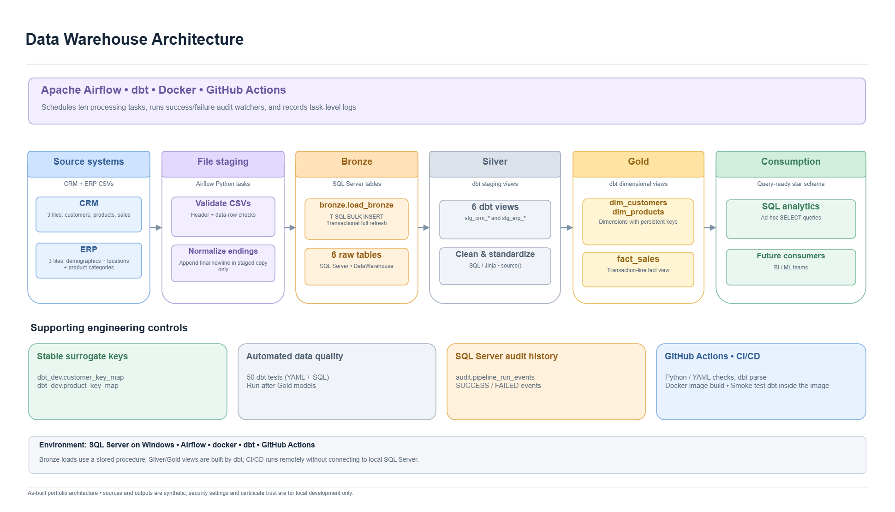
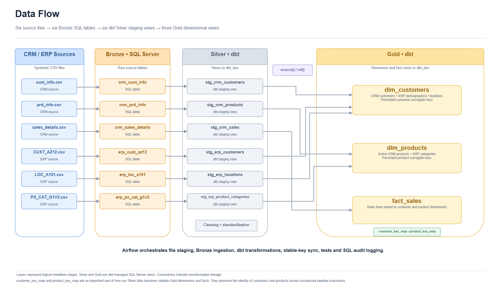
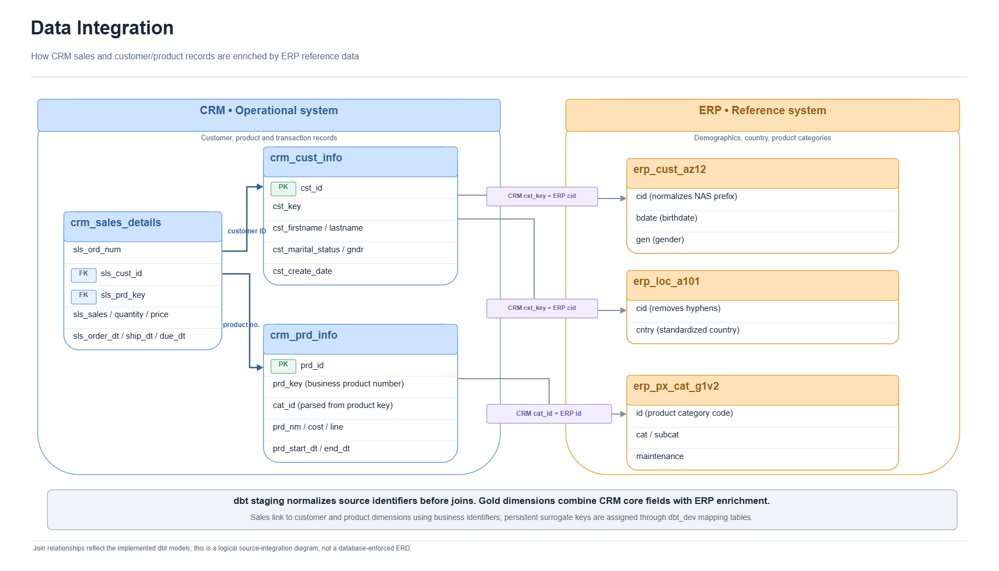
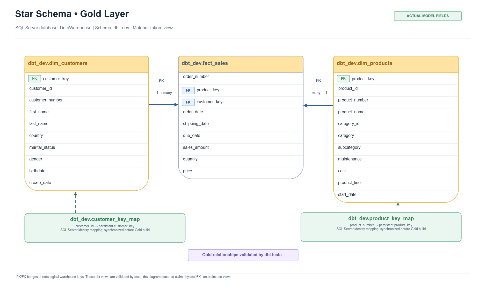
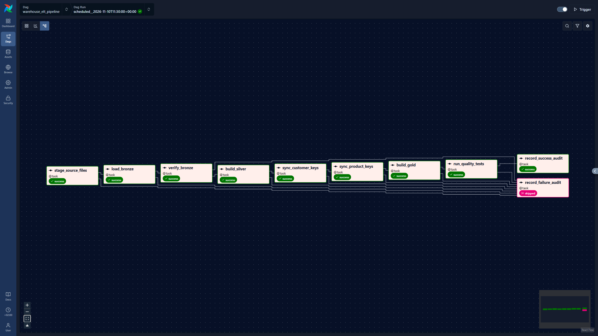

# SQL Server Data Warehouse | Airflow • dbt • Docker • GitHub Actions

An end-to-end **Data Engineering portfolio project** that integrates synthetic CRM and ERP data into a SQL Server data warehouse using the Medallion architecture. Apache Airflow orchestrates ingestion, transformations, persistent surrogate-key management, automated data-quality testing, and execution auditing.

## Architecture

| Layer / service | Technology | Responsibility |
| --- | --- | --- |
| Source systems | Six CRM and ERP CSV files | Synthetic customer, product, sales, location, and category data |
| Staging / ingestion | Airflow Python tasks, SQL Server T-SQL | Verify source CSVs, normalize missing final line endings in staged copies, and load Bronze using a transactional `BULK INSERT` procedure |
| Bronze | SQL Server tables in `bronze` | Preserve raw source data |
| Silver | dbt Core + SQL Server views in `dbt_dev` | Clean, deduplicate, standardize, and validate CRM/ERP data |
| Persistent key mappings | SQL Server tables in `dbt_dev` | Keep customer and product surrogate keys stable across reloads |
| Gold | dbt Core + SQL Server views in `dbt_dev` | Create `dim_customers`, `dim_products`, and `fact_sales` |
| Quality tests | dbt tests | Run 50 YAML-declared and singular SQL data tests after building models |
| Orchestration / monitoring | Apache Airflow 3.4, Docker Compose, SQL Server `audit` schema | Schedule tasks, track failures, and record pipeline outcomes |
| Continuous integration (CI) | GitHub Actions (`warehouse-ci.yml`) | Validate Python/YAML and repository structure, parse dbt offline, and build the Airflow + dbt container; **successfully executed on GitHub** |
| Continuous delivery (CD) | GitHub Actions (`warehouse-cd.yml`), GHCR | On release tags, rerun CI, publish a versioned container image, verify registry availability, and smoke-test dbt inside the image |

**Implementation detail:** Bronze is a physical SQL Server schema. The terms *Silver* and *Gold* describe transformation layers; the actively built dbt views live in SQL Server's `dbt_dev` schema

### Data Flow

The following diagram illustrates how data moves through the Medallion Architecture, from the six CRM and ERP source datasets to the Bronze, Silver, and Gold layers.

*Figure: End-to-end data flow showing SQL Server Bronze ingestion, dbt Silver transformations, persistent surrogate-key mappings, and Gold dimensional models.*

## Data models

### CRM and ERP Data Integration

The following diagram illustrates the relationships between the CRM and ERP source systems. CRM provides customer, product, and sales transaction data, while ERP enriches the warehouse with customer demographics, geographic information, and product categories.

*Figure: Integration of CRM and ERP datasets using shared customer and product business identifiers.*

The Gold layer is a star schema consisting of:

- **`dbt_dev.dim_customers`** — CRM customer attributes enriched with ERP demographics and locations.
- **`dbt_dev.dim_products`** — active product records enriched with ERP category information.
- **`dbt_dev.fact_sales`** — sales transaction lines with customer and product surrogate keys, quantities, dates, and sales amounts.

The physical tables **`dbt_dev.customer_key_map`** and **`dbt_dev.product_key_map`** assign and preserve surrogate keys across full refreshes. Airflow invokes dbt synchronization macros before rebuilding Gold views. These mappings prevent existing business entities from receiving different surrogate keys simply because row ordering changes.

## Airflow pipeline

### Apache Airflow DAG — ELT Pipeline

The following graph shows the `warehouse_elt_pipeline` DAG running successfully in Apache Airflow 3.4. The DAG orchestrates the complete ELT workflow, from CSV ingestion and Bronze loading to dbt transformations, persistent surrogate-key synchronization, automated data-quality testing, and SQL Server execution auditing.

*Figure: Successful scheduled execution of the Airflow DAG, with nine successful tasks and one intentionally skipped failure-audit task.*

The `warehouse_elt_pipeline` DAG in `orchestration/airflow/dags/03_warehouse_elt_pipeline.py` runs **daily at 13:30 Europe/Athens** and supports manual triggers. It does not backfill historical runs (`catchup=False`) and does not allow overlapping runs.

| Order | Task | Function |
| ---: | --- | --- |
| 1 | `stage_source_files` | Validate and stage the CSVs; append a missing final newline **only to the staged copy** |
| 2 | `load_bronze` | Call the transactional `bronze.load_bronze` stored procedure |
| 3 | `verify_bronze` | Check Bronze readiness with a dbt macro |
| 4 | `build_silver` | Build the six CRM/ERP staging views |
| 5 | `sync_customer_keys` | Synchronize persistent customer surrogate keys |
| 6 | `sync_product_keys` | Synchronize persistent product surrogate keys |
| 7 | `build_gold` | Build two dimensions and the sales fact view |
| 8 | `run_quality_tests` | Execute the dbt test suite |
| 9 | `record_success_audit` | Write a SQL Server `SUCCESS` event if processing succeeds |
| 10 | `record_failure_audit` | On upstream failure, attempt to write a `FAILED` event and preserve the failed DAG status |

The two audit tasks are conditional: **a normal successful run has nine successful tasks and one skipped failure-audit task**. Audit-writing errors are propagated so missing audit records are not silently reported as success.

### Validated run

A completed local end-to-end run successfully processed the six Bronze datasets, built Silver and Gold views, passed its dbt tests, and inserted a SQL Server success audit event. The verified Bronze row counts were:

| Bronze table | Rows |
| --- | ---: |
| `bronze.crm_cust_info` | 18,494 |
| `bronze.crm_prd_info` | 397 |
| `bronze.crm_sales_details` | 60,398 |
| `bronze.erp_cust_az12` | 18,484 |
| `bronze.erp_loc_a101` | 18,484 |
| `bronze.erp_px_cat_g1v2` | 37 |

An ingestion edge case was found and fixed: some source CSVs lacked a terminating newline, which caused SQL Server to miss the final record. The staging task now normalizes the **staged copies**, leaving the source files unchanged. The corrected behavior was verified in a complete Airflow run.

## CI/CD — GitHub Actions and GitHub Container Registry

The project uses **GitHub Actions** to validate changes to warehouse code and to deliver a tested Airflow + dbt Docker image. The **CI workflow has passed on GitHub**, and the first **CD release (`v1.0.0`) has been published and verified**.

### Continuous Integration (CI)

The [Warehouse CI workflow](.github/workflows/warehouse-ci.yml) runs on code pushes and pull requests, performing three checks:

1. **Python, YAML, and repository structure:** Validate syntax and required files, including checks against accidentally tracked local credential files.
2. **Offline dbt project validation:** Parse the dbt project with a disposable, nonfunctional profile, without connecting to SQL Server.
3. **Airflow + dbt Docker build:** Verify that the custom runtime image can be built successfully, without publishing the CI build.

### Continuous Delivery (CD)

The [Warehouse CD workflow](.github/workflows/warehouse-cd.yml) is triggered by a version tag such as `v1.0.0`. It:

1. Reuses the CI workflow to validate the tagged release.
2. Builds and pushes a versioned Airflow + dbt image to **GitHub Container Registry (GHCR)**.
3. Confirms the published image is available in the registry.
4. Performs a **dbt smoke test inside the published image**. 

## Security and scope

- The Airflow development UI is configured to bind to localhost and uses private credentials loaded from a Git-ignored environment file.
- SQL Server ingestion and audit operations use separate accounts with task-specific permissions.
- The local SQL Server ODBC connections use `Encrypt=yes;TrustServerCertificate=yes`. Certificate verification is relaxed **for local development only**; production systems should validate server certificates.
- The synthetic CSVs are educational sample data. This project is **Data Engineering-focused**; it does not contain a BI dashboard or machine-learning deployment.
- SQL Server initialization/reset scripts require care; in particular, don't rerun destructive Bronze DDL against existing data.

## Project status

- **Local ELT pipeline:** built and end-to-end validated.
- **Database audit logging:** validated for successful and intentionally failed test runs.
- **Automated dbt testing:** integrated and exercised in the local Airflow pipeline.
- **GitHub Actions CI:** verified successful on GitHub (Python/YAML checks, offline dbt parsing, and Docker build).
- **GitHub Actions CD:** verified successful for the `v1.0.0` release, with the image published to GHCR and dbt smoke-tested.
- **Deployment:** local Airflow + SQL Server runs independently; automated deployment is not configured.